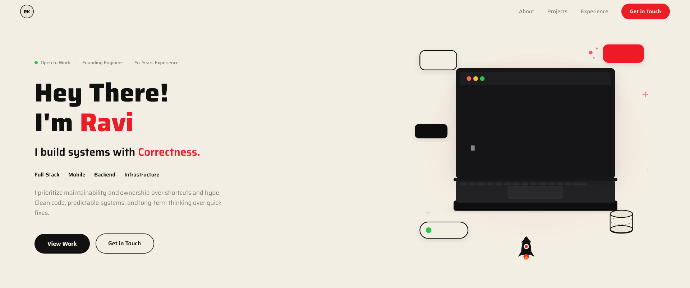

# Ravi Kovind

**Founding Engineer** | Full-Stack | Mobile | Backend | Infrastructure

[](https://ravikovind.github.io)
[](https://linkedin.com/in/ravikovind)
[](https://x.com/ravi_kovind)
[](https://pub.dev/publishers/voltvave.com/packages)

---

<video src="branding/reel.mp4" autoplay loop muted playsinline width="320" style="border-radius:16px"></video>

> [Download Portfolio Reel](branding/reel.mp4) — 1080×1920, ~70s, H.264/AAC



## About

Founding Engineer with 5+ years taking products from 0 to 1, operating production systems, and building AI/MCP infrastructure. NIT Allahabad alumni.

> *I prioritize maintainability and ownership over shortcuts and hype. Clean code, predictable systems, and long-term thinking over quick fixes.*

## Highlights

| Metric | Value |
|--------|-------|
| Years of Experience | 5+ |
| Apps Built | 10+ |
| Users Served | 30K+ |
| Orders Processed | 80K+ |
| Package Downloads | 6.4K+ |

## Tech Stack

**Languages:** Dart, JavaScript, TypeScript, Python, Java

**Frameworks:** Flutter, React, Next.js, Node.js, Express, FastAPI

**Databases:** PostgreSQL, MongoDB, Redis, MySQL

**Infrastructure:** AWS, GCP, Docker, NGINX, Linux

**Tools:** Firebase, Git, GitHub, Kafka, MCP

## Featured Projects

### TingTing
Hyperlocal grocery delivery ecosystem connecting customers, stores, pickers, and delivery partners. Built complete suite of apps with real-time order tracking and ERP integration.
- 35+ Live Stores | 30K+ Users | 80K+ Orders | ₹1.5Cr+ Revenue

### HyperFrames
CLI for creating, inspecting, validating, and rendering programmatic HTML-based videos. Runs interactively for developers or fully automated by AI coding agents via `npx hyperframes`.

### snap-x
CLI tool for rendering social media images from Satori `.mjs` design files. Node.js, zero-config, any size.

### MCPVave
Cross-platform MCP client that connects to MCP servers using SSE & STDIO. Works on mobile, desktop, and web.

### Tredye
Real-time trading dashboard with microservices architecture. Live market data streaming, RSI calculation, divergence detection, and news aggregation.

### Bhagavad Gita
Complete Bhagavad Gita app with all 18 chapters. 40K+ downloads, 2K daily users. Free, no ads.

## Open Source

| Package | Stats |
|---------|-------|
| [flutter_lucide](https://pub.dev/packages/flutter_lucide) | 3.9K downloads |
| [Bhagavad Gita](https://play.google.com/store/apps/details?id=com.gita) | 40K+ downloads, 2K/day |
| [gen-images](https://github.com/ravikovind/gen-images) | AI image generation pipeline |
| [recipe_x](https://github.com/ravikovind/recipe_x) | 45K+ recipes worldwide |

## Portfolio Features

- **Page Tour** — swarmline-powered multi-cursor page scan animation (ink + red theme)
- Particle network hero background (brand red + ink black)
- Typing effect with dynamic words
- Horizontal scrolling tech stack timeline
- Embedded X posts (dark theme)
- Responsive mobile-first design, cream/ink/red palette
- SEO optimized with structured data

## Run Locally

```bash
git clone https://github.com/ravikovind/ravikovind.github.io.git
cd ravikovind.github.io
open index.html
```

## Branding

Portfolio reel and brand assets are generated programmatically. Scripts live in [`branding/`](branding/).

### Portfolio Reel — `branding/record-tour.mjs`

Records the live portfolio website with the Page Tour animation running, then encodes a phone-format MP4.

**Requirements:** Node.js 22+, Chromium, FFmpeg, Python 3

```bash
# Install Playwright (one-time)
npm install playwright-core
npx playwright install ffmpeg

# Record and encode
node branding/record-tour.mjs
# Output: ravi-final.mp4 (1080×1920, ~70s, H.264 Baseline + AAC)
```

**How it works:**
1. Launches headless Chromium at `540×960` viewport (9:16 mobile, matches recordVideo canvas exactly — no letterboxing)
2. Clears `localStorage` to force the first-visit Page Tour prompt
3. Clicks "Start Tour" — triggers the swarmline animation across the page
4. Scrolls through the full page over ~120 seconds (40 steps × 3s each)
5. Saves raw VP9 WebM via Playwright's built-in video recorder
6. Generates a procedural background music track (`branding/gen-music.py`) matched to the final duration
7. FFmpeg encodes: 2× speed (`setpts=0.5*PTS`) + lanczos 2× upscale to 1080×1920 + AAC audio + music fade-out

### Background Music — `branding/gen-music.py`

Pure-Python procedural music generator — no dependencies beyond the standard library.

```bash
python3 branding/gen-music.py output.wav 60
# Generates 60s of 128 BPM beat (kick/snare/hihat + Am pentatonic bass + pad chords)
```

**Args:** `<output.wav> <duration_seconds>`

## Contact

- **Email:** hey.ravikovind@gmail.com
- **LinkedIn:** [ravikovind](https://linkedin.com/in/ravikovind)
- **GitHub:** [ravikovind](https://github.com/ravikovind)
- **X:** [@ravi_kovind](https://x.com/ravi_kovind)

---

**V 3.0.0** | Built with clarity.

[View Repository](https://github.com/ravikovind/ravikovind.github.io)
